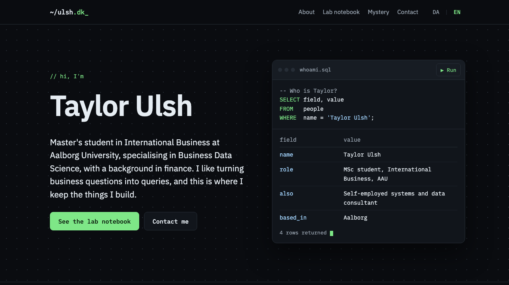

# ulsh.dk - Personal Homepage as a SQL Query
> treating myself like a database  
> available at [ulsh.dk](https://ulsh.dk)

## Introduction

I like turning business questions into queries, so my homepage is built around SQL, including:
* a small SQL window that "queries" me and returns a results table
* section labels written as queries, such as `SELECT * FROM projects;`
* a lab notebook of what I'm building, with status badges
* Danish and English versions that follow your browser language and remember your choice (using the LocalStorage API)
* a layout that works on phones
* plain HTML, CSS and JavaScript, with no framework

### fun stuff to try

* run the query again using the `▶ Run` button in the SQL window
* switch languages using `DA | EN`
* query a page that doesn't exist, such as [ulsh.dk/nope](https://ulsh.dk/nope)
* add a row to `messages` using the contact form

_and a SQL mystery game is on its way_

## Status

Live and still changing. Next up is the SQL mystery game, which will get its own repository.
